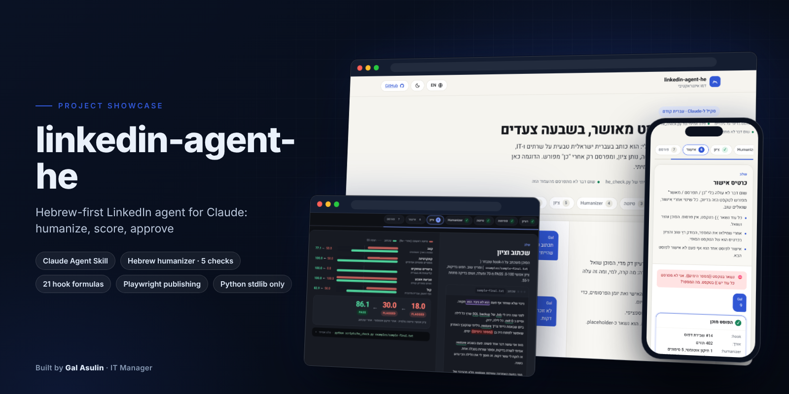
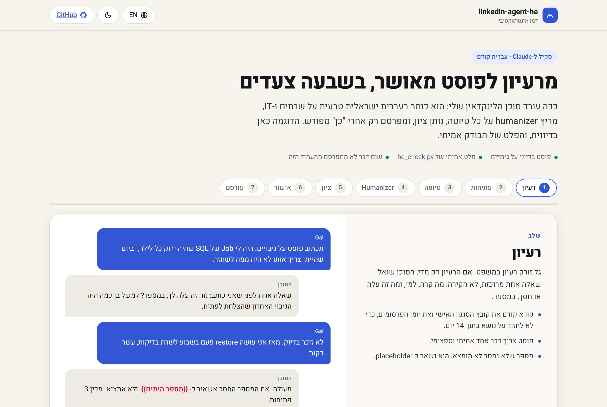
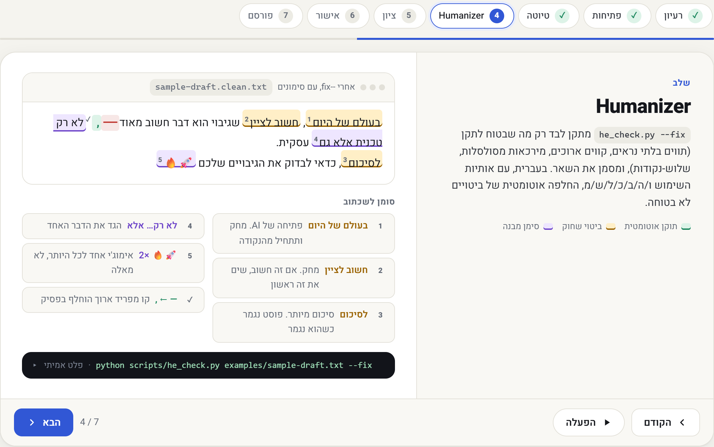
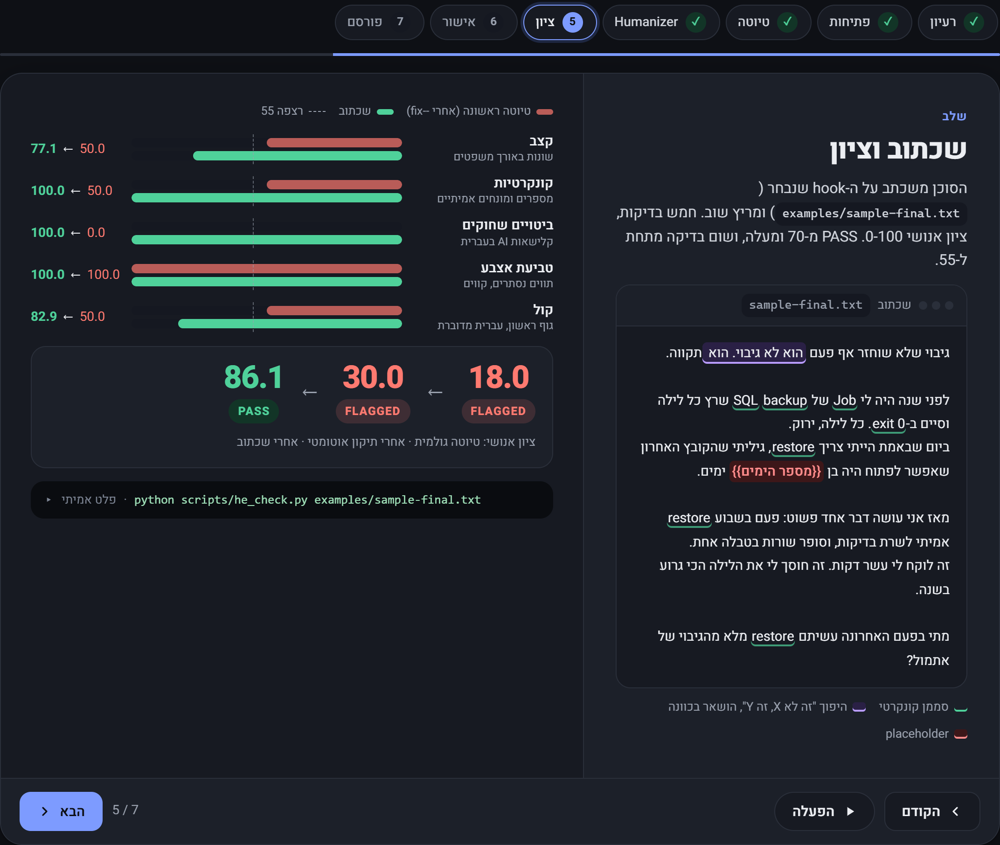
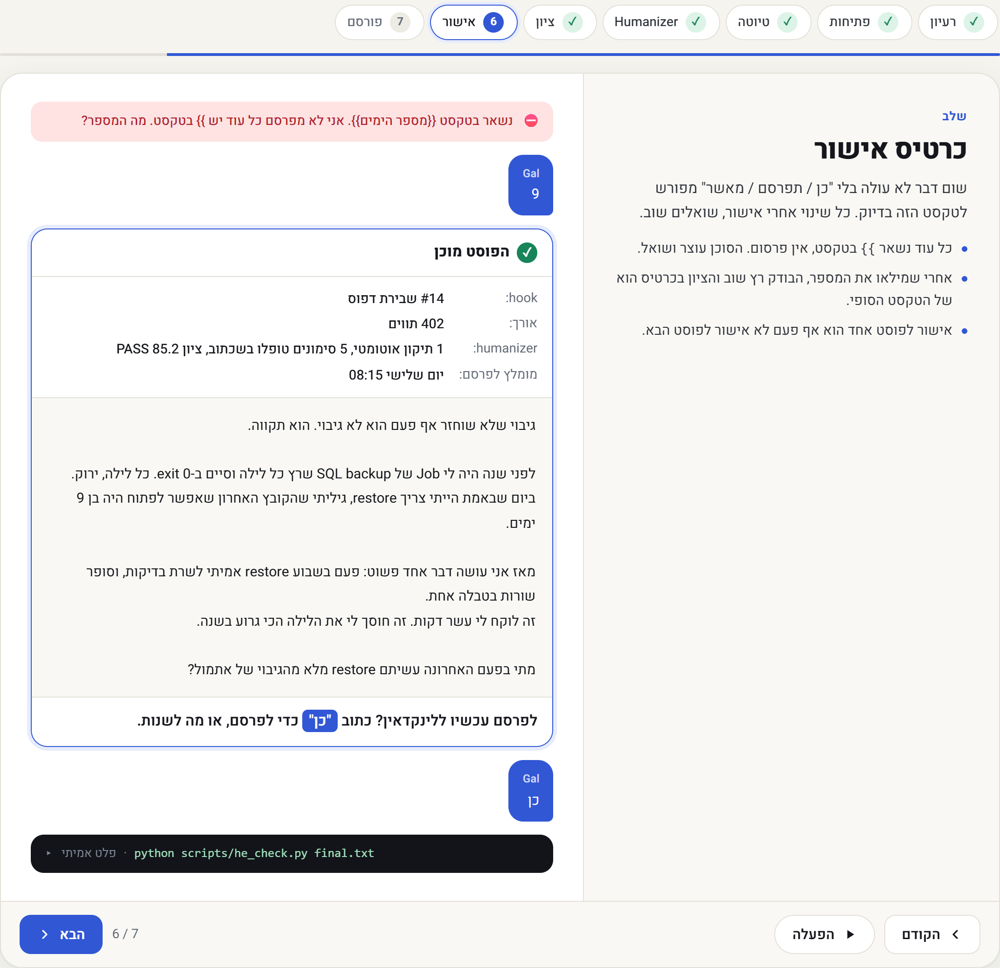
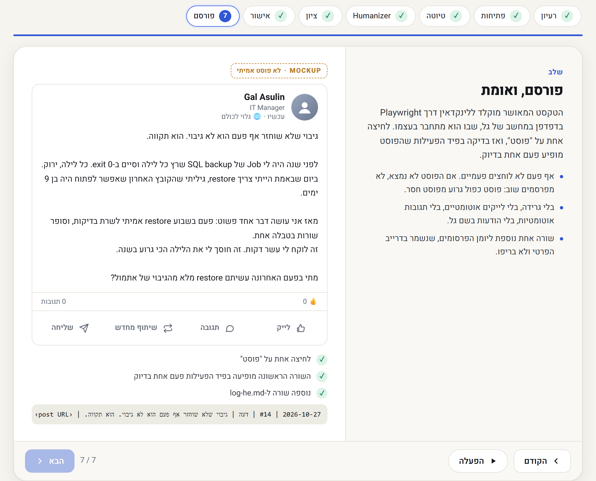
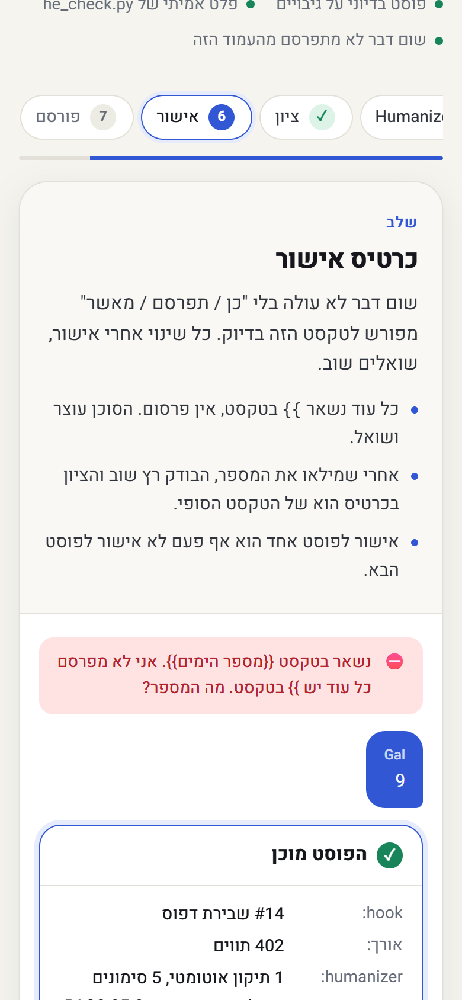
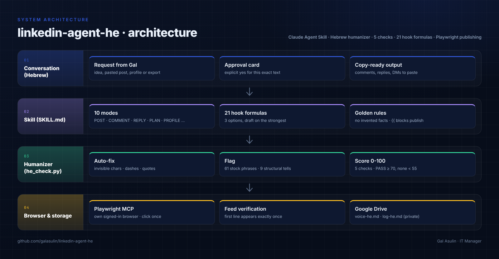

<p align="center"><a href="https://galasulin.github.io/linkedin-agent-he/"></a></p>

<div align="center">

# linkedin-agent-he

**סוכן לינקדאין בעברית שרץ על Claude: מוצא נושאים, כותב פוסט, מעצב פוסטר, שולח לאישור, ומפרסם רק אחרי אישור מפורש של בעל החשבון.**

🇬🇧 [English](README.md) · 🇮🇱 עברית


[**דמו חי**](https://galasulin.github.io/linkedin-agent-he/) · [מסכים](#מסכים) · [ארכיטקטורה](#ארכיטקטורה) · [טכנולוגיה](#פרמטרים-טכניים)

</div>

<p align="center"><a href="https://galasulin.github.io/linkedin-agent-he/"></a><br><sub>הדמו החי עובר צעד אחר צעד על כל התהליך, עם פוסט בדיוני ופלט אמיתי של <code>he_check.py</code>.</sub></p>

<div dir="rtl" align="right">

## במבט מהיר

| | |
|---|---|
| **סוג** | סקיל ל-Claude ‏(`SKILL.md`), בודק טקסט עברי עצמאי (`he_check.py`) ודף דמו אינטראקטיבי |
| **סטטוס** | בשימוש שוטף בלינקדאין של בעל החשבון |
| **סטאק** | Claude Agent Skills · ‏Playwright MCP · ‏Python 3 (ספרייה סטנדרטית בלבד) · מחבר Google Drive |
| **התפקיד שלי** | זרימת העבודה, כללי האישור והבטיחות, ספריית הפתיחות בעברית, כללי ה-humanizer, שלבי הפרסום בדפדפן, הבודק והדמו |
| **דמו חי** | [galasulin.github.io/linkedin-agent-he](https://galasulin.github.io/linkedin-agent-he/) |
| **שפות** | עברית (פוסטים וכל תשובות הסוכן) · אנגלית (הוראות הסקיל ותיעוד) · הדמו בשתיהן |

## מסכים

<table>
<tr>
<td width="33%"><a href="docs/assets/demo-1.png"></a><br><sub><b>רעיון</b> · שאלה אחת מרוכזת, ומספר חסר הופך ל-placeholder</sub></td>
<td width="33%"><a href="docs/assets/demo-2.png"></a><br><sub><b>Humanizer</b> · תיקונים אוטומטיים וביטויים שחוקים מסומנים בטיוטה</sub></td>
<td width="33%"><a href="docs/assets/demo-3.png"></a><br><sub><b>ציון</b> · חמש בדיקות, 18.0 ← 30.0 ← ‏86.1 PASS</sub></td>
</tr>
<tr>
<td><a href="docs/assets/demo-4.png"></a><br><sub><b>כרטיס אישור</b> · חסום כל עוד נשאר placeholder של <code>{{</code></sub></td>
<td><a href="docs/assets/demo-5.png"></a><br><sub><b>פורסם</b> · הדמיית פוסט, אימות אחד בפיד הפעילות</sub></td>
<td><a href="docs/assets/demo-6.png"></a><br><sub><b>מובייל</b> · הדמו ברוחב טלפון, מימין לשמאל</sub></td>
</tr>
</table>

<sub>כל המסכים מדף הדמו. הפוסט בדיוני, ושום דבר לא מתפרסם מהדמו.</sub>

## מה זה

סוכן לינקדאין בעברית שרץ על Claude. הוא מוצא נושא, כותב פוסט, מעצב לו פוסטר, שולח לאישור את הטקסט, את הפוסטר ואת שעת הפרסום, ומפרסם רק אחרי אישור מפורש של בעל החשבון.

כלי כתיבה כלליים מוציאים עברית מתורגמת ומלוטשת מדי, שמזהים אותה מהשורה הראשונה. הסוכן הזה כותב בעברית ישראלית טבעית על AI, אבטחת מידע ושרתים, בודק כל מספר מול המקור הראשי, ומעביר כל טיוטה בבודק עברית מקומי שמזהה ניסוחים של AI ונותן ציון, עוד לפני שמישהו רואה אותה.

## יכולות מרכזיות

### מצבי עבודה

| מצב | מה מקבלים |
|---|---|
| **נושאים** | נושאים משני מקורות: חדשות של 72 השעות האחרונות (AI, אבטחת מידע, שרתים) ובנק רעיונות שמתעדכן כל יום. כל מספר נבדק מול המקור הראשי. |
| **פוסט** | 3 פתיחות מתוך 21 נוסחאות פתיחה בעברית ← טיוטה מלאה בצורה שמשתנה מפעם לפעם (900-1,300 תווים, שורה ראשונה ששורדת את החיתוך של כ-140 תווים במובייל, עד 3 האשטגים, בלי לינק בגוף) ← humanizer ← ציון ← פוסטר ← אישור |
| **פוסטר** | פוסטר אחד לכל פוסט, 1080×1350, באחד מ-10 סגנונות עיצוב בלי חזרות, אחרי חיפוש השראה ברשת |
| **וידאו** | סרטון של 15-30 שניות לפוסטים מיוחדים |
| **תגובה** | 2 הצעות תגובה מסוגים שונים לפוסטים של אחרים (9 סוגים, למשל הוספת נתון, אי-הסכמה מכבדת, שורה אחת), 2-4 משפטים, בלי פתיחות כמו "פוסט מעולה". מוכנות להדבקה, לא נשלחות אוטומטית |
| **מענה** | תשובות לתגובות על הפוסטים של בעל החשבון, ממוינות לליד / תוכן / עמית / תמיכה / רעש ונענות לפי הסדר הזה. מוכנות להדבקה, לא נשלחות אוטומטית |
| **תוכנית שבועית** | פוסט רגיל כל יום, מראשון עד חמישי, כל אחד בשעת פרסום שונה; הנושאים נבדקים מול היומן כדי שלא יחזרו בתוך 14 יום |
| **קרוסלה** | קרוסלה כקובץ PDF פעם בשבועיים, 8-10 שקפים בגודל 1080×1350 |
| **פוסט נוסף** | פוסט נוסף, מעבר לפוסט היומי, כשיש הכרזה גדולה ב-AI |
| **פרופיל** | ציון פרופיל מתוך 100 ב-12 סעיפים ושכתוב לפי סדר עדיפות (כותרת עד 220 תווים, אודות, ניסיון), שמוחל בדפדפן אחרי אישור |
| **הודעות** | הודעות קצרות, מוכנות להדבקה, שבעל החשבון שולח בעצמו |
| **סיכום חודשי** | הסוכן קורא את הנתונים של הפוסטים של בעל החשבון בלבד (חשיפות, תגובות), משווה לפי סוג פוסט, פתיחה, שעת פרסום ופוסטר, ומחזיר מסקנות |

### הכללים שלא נשברים

1. **טיוטה ← אישור ← פרסום.** הטקסט, הפוסטר ושעת הפרסום עוברים אישור. שום דבר לא עולה בלי "כן / תפרסם / מאשר" מפורש. כל שינוי אחרי האישור מחזיר את הפוסט לאישור מחדש. בלי תשובה לא מתפרסם כלום. אישור לפוסט אחד הוא אף פעם לא אישור לפוסט הבא.
2. **בלי להמציא.** אין המצאת אירועים, מספרים או לקוחות. כל מספר נבדק מול המקור הראשי. מספר חסר הופך ל-`{{המספר שלך}}`, ואין פרסום כל עוד נשאר `{{` בטקסט.
3. **פרסום דרך הדפדפן של בעל החשבון.** הפוסט המאושר מוקלד ללינקדאין דרך דפדפן Playwright במחשב של בעל החשבון, שבו הוא מחובר בעצמו. הסוכן לא מקליד סיסמה, עובד רק בלשונית של לינקדאין ולא נוגע בלשוניות אחרות, ולוחץ על "פרסום" פעם אחת בלבד. אחרי הפרסום הוא בודק שהפוסט עלה פעם אחת, מיושר לימין ועם האשטגים פעילים, ומוסיף את המקור בתגובה הראשונה.
4. **כל טיוטה עוברת humanizer וציון** לפני שמישהו רואה אותה. מוצג הטקסט הנקי יחד עם הציון, אף פעם לא הציון לבד.
5. **RTL.** כל שורה מתחילה במילה בעברית. תווי הכיוון מתווספים רק בזמן הפרסום.
6. **סודיות.** בלי שמות לקוחות, שמות שרתים, כתובות IP או פרטי אבטחה של ספקים, אלא אם בעל החשבון כתב אותם בעצמו.

### פוסטר לכל פוסט

כל פוסט מקבל פוסטר בגודל 1080×1350, עם רצועת חתימה קבועה בתחתית. העיצוב נבחר מספרייה של 10 סגנונות, וסגנון לא חוזר עד שהאחרים נוצלו:

אפל 3D · פסל 3D · מינימליזם נועז · גרף מגזיני · ניאו-ברוטליזם · שלטי אזהרה · כרום Y2K · קולאז' · גרדיאנט זוהר · גליץ'

לפני כל פוסטר הסוכן מחפש ברשת השראה מעבודות עיצוב עדכניות, ואז בונה גרפיקה אחת מהמספרים האמיתיים של הסיפור. הפוסטר נבנה כ-HTML ומצולם ל-PNG.

### וידאו

פוסט מיוחד יכול לקבל סרטון של 15-30 שניות במקום פוסטר. הסרטון עובר את אותו אישור כמו הטקסט.

### קצב

פוסט רגיל כל יום, מראשון עד חמישי, כל אחד בשעת פרסום שונה. פוסט נוסף כשיש הכרזה גדולה ב-AI. קרוסלה (PDF) פעם בשבועיים.

### מה הסוכן לא עושה

הוא לא סורק את הפיד. הוא לא מגיב ולא מתחבר לאנשים אוטומטית. הוא לא שולח הודעות פרטיות. הוא לא מפרסם בלי אישור.

### ה-humanizer העברי (`scripts/he_check.py`)

קובץ אחד בלי תלויות, שבנוי למורפולוגיה של עברית (אותיות השימוש ו/ה/ב/כ/ל/ש/מ):

- **מתקן אוטומטית** תווים בלתי נראים, קווים מפרידים ארוכים, מירכאות מסולסלות, שלוש-נקודות ותבליטים;
- **מסמן** 61 ביטויי AI שחוקים בעברית ("בעולם של היום", "חשוב לציין", "לסיכום", "למנף"…), כל אחד עם סיבה והצעת תיקון, ו-9 סימני מבנה ("לא רק… אלא", "זה לא X, זה Y", שורת חשיפה מבוימת, שלישיות, אימוג'י של AI, קיר האשטגים, פיתיון מעורבות, ניקוד);
- **מדרג** חמש בדיקות (קצב, קונקרטיות, ביטויים שחוקים, טביעת אצבע, קול) לציון אנושי 0-100: ‏`PASS` מ-70 ומעלה, בלי בדיקה מתחת ל-55. היעד של הסוכן עצמו גבוה יותר: 85 ומעלה לפני שטיוטה מוצגת, בשאיפה ל-90 ומעלה.

<div dir="ltr">

```text
python scripts/he_check.py examples/sample-draft.txt --fix   # 18.0  FLAGGED
python scripts/he_check.py examples/sample-final.txt         # 86.1  PASS
python tests/test_he_check.py                                # 3 smoke tests
```

</div>

זו היוריסטיקה מקומית ולא גלאי AI מסחרי, והסקיל אף פעם לא טוען שטקסט "בלתי ניתן לזיהוי". שתי הדוגמאות בדיוניות, לא פוסטים אמיתיים.

## ארכיטקטורה



הסקיל הוא קובץ `SKILL.md` אחד ש-Claude טוען כשאני מבקש עבודה על לינקדאין. הוא קורא שני קבצים פרטיים מה-Google Drive שלי (`voice-he.md`, פרופיל הסגנון, ו-`log-he.md`, שורה לכל פוסט שפורסם), בוחר מצב וכותב טיוטה. שלב ה-humanizer כותב את `he_check.py` (מוטמע מילה במילה ב-`SKILL.md`; ‏`scripts/he_check.py` הוא אותו בודק ועוד שורה אחת שמגדירה פלט UTF-8 לקונסולת Windows) לתיקיית העבודה של השיחה, מריץ אותו עם `--fix`, משכתב כל שורה מסומנת ומריץ שוב עד שהטקסט עובר. כרטיס האישור הוא השער היחיד לשכבת הפרסום: ‏Playwright MCP מפעיל את הדפדפן במחשב שלי, מקליד את הטקסט המאושר בדיוק, לוחץ "פרסום" פעם אחת, מאמת שהפוסט עלה, מוסיף את המקור בתגובה הראשונה ומוסיף שורה ליומן.

### זרימה

```mermaid
flowchart LR
    A["News of the last 72 h + idea bank"] --> B["Numbers checked against the primary source"]
    B --> C["3 hooks + draft"]
    C --> D["he_check.py: fix, flag, score"]
    D -->|"rewrite until PASS"| C
    D --> P["Poster 1080x1350, HTML to PNG"]
    P --> E["Approval: text, poster, posting time"]
    E -->|"explicit yes"| F["Playwright: LinkedIn tab only, click Post once"]
    F --> G["Verify: posted once, right-aligned, hashtags active"]
    G --> H["Source in the first comment, append to log"]
    E -->|"any change"| C
```

<div dir="ltr">



</div>

## פרמטרים טכניים

| פרמטר | ערך |
|---|---|
| הסקיל (הגרסה שפורסמה) | `SKILL.md`, ‏395 שורות: SETUP, ‏5 כללי זהב, ‏11 מצבים (POST, ‏COMMENT, ‏REPLY, ‏PLAN, ‏PROFILE, ‏CAROUSEL, ‏VIDEO, ‏REPURPOSE, ‏DM, ‏INBOX, ‏AUDIT), ופרקים T ‏(נושאים), ‏R ‏(RTL), ‏I ‏(פוסטר), ‏H ‏(humanizer), ‏P ‏(פרסום), ‏P2 ‏(עריכת פרופיל), ‏V ‏(תבנית הסגנון), ‏S ‏(קוד הבודק) |
| ספריית פתיחות | 21 נוסחאות hook בעברית, ממוספרות, והמספר מופיע בכרטיס האישור וביומן |
| סיווג תגובות ומענים | 9 סוגי תגובה · 5 קבוצות מענה (ליד, תוכן, עמית, תמיכה, רעש) |
| ציון פרופיל | 12 סעיפים משוקללים שמסתכמים ב-100 |
| מבנה פוסט | 900-1,300 תווים · שורת פתיחה ששורדת חיתוך של כ-140 תווים במובייל · עד 3 האשטגים · בלי לינק בגוף |
| מקורות לנושאים | חדשות של 72 השעות האחרונות (AI, אבטחת מידע, שרתים) · בנק רעיונות שמתעדכן כל יום · כל מספר נבדק מול המקור הראשי |
| כלל RTL | כל שורה מתחילה במילה בעברית · תווי הכיוון מתווספים רק בזמן הפרסום |
| פוסטר | 1080×1350 · רצועת חתימה קבועה בתחתית · ספרייה של 10 סגנונות בלי חזרות · השראה מהרשת לפני כל פוסטר · גרפיקה אחת מהמספרים האמיתיים של הסיפור · נבנה כ-HTML ומצולם ל-PNG |
| וידאו | 15-30 שניות, לפוסטים מיוחדים |
| קצב | פוסט רגיל ביום, מראשון עד חמישי · שעת פרסום שונה בכל פעם · פוסט נוסף בהכרזה גדולה ב-AI · קרוסלה (PDF) פעם בשבועיים |
| יעד ה-humanizer | 85 ומעלה לפני שטיוטה מוצגת, בשאיפה ל-90 ומעלה (קו ה-`PASS` של הבודק עצמו נשאר 70) |
| סיכום חודשי | הפוסטים של בעל החשבון בלבד: חשיפות ותגובות, בהשוואה לפי סוג פוסט, פתיחה, שעת פרסום ופוסטר |
| הבודק | `scripts/he_check.py`, ‏140 שורות, ‏Python 3 עם ספרייה סטנדרטית בלבד (`json`, ‏`re`, ‏`statistics`, ‏`unicodedata`) |
| כללי הבודק | 61 ביטויים שחוקים עם התאמה שמכירה אותיות שימוש · 9 ביטויים רגולריים למבנה · 11 החלפות טיפוגרפיות · הסרת תווי Unicode מסוג `Cf` (בלתי נראים) |
| חמש הבדיקות | קצב: מקדם השונות של אורכי המשפטים (לפחות 4 משפטים) · קונקרטיות: מספרים ומונחים טכניים באנגלית ל-100 מילים · ביטויים שחוקים ל-100 מילים · טביעת אצבע: תווים בלתי נראים, קווים ארוכים, מירכאות מסולסלות ושלוש-נקודות ל-1,000 תווים · קול: גוף ראשון ושני 40%, שפה מדוברת 25%, סימני מבנה 35% |
| ציון כולל | `0.6 × ממוצע + 0.4 × מינימום` של חמש הבדיקות |
| פסיקות | `PASS` מ-70 ומעלה וכל בדיקה לפחות 55 · `REVIEW` מ-50 · `FLAGGED` מתחת ל-50 · קוד יציאה 0 רק ב-`PASS` |
| שורת פקודה | `he_check.py <file \| -> [--fix] [--json]`; ‏`--fix` כותב `<name>.clean.txt` ומדרג לפני ואחרי; פלט UTF-8 גם בקונסולת Windows |
| סבב שכתוב | 2 סבבים זה נורמלי; אחרי 4 סבבים בלי `PASS` הטיוטה נזרקת ונכתבת מחדש |
| תוצאות הדוגמאות | `sample-draft.txt` ‏18.0 FLAGGED ← ‏30.0 אחרי `--fix` ← ‏`sample-final.txt` ‏86.1 PASS |
| בדיקות | `tests/test_he_check.py`, ‏3 בדיקות smoke (רצות עם pytest או בלעדיו) |
| פרסום | Playwright MCP על הדפדפן של בעל החשבון, שבו הוא מחובר בעצמו · רק בלשונית של לינקדאין · בלי הקלדת סיסמה · סימון אלמנטים ב-`data-cl` דרך `browser_evaluate` · לחיצה אחת · בדיקה אחרי הפרסום: עלה פעם אחת, מיושר לימין, האשטגים פעילים · המקור בתגובה הראשונה |
| אחסון | `voice-he.md` ו-`log-he.md` ב-Google Drive, אף פעם לא בריפו |
| דף הדמו | `docs/index.html`, קובץ יחיד (כ-71KB), ‏7 שלבים, מעבר עברית/אנגלית, מצב בהיר/כהה, נתונים בדיוניים |

## החלטות הנדסיות

| ההחלטה | למה | המחיר |
|---|---|---|
| **הבודק מסמן עברית, אף פעם לא משכתב אותה** | אותיות השימוש והתאמת המין הופכות שכתוב ב-regex למסוכן. רק הטיפוגרפיה מתוקנת אוטומטית; את השורות המסומנות המודל משכתב לפי שיקול דעת. | כל סימון עולה סבב שכתוב. |
| **הציון הכולל נותן משקל לבדיקה החלשה** | `0.6 × ממוצע + 0.4 × מינימום` ורצפה של 55 מונעים מבדיקה חזקה אחת להסתיר בדיקה גרועה. | פוסטים קצרים מקבלים 50 ניטרלי בבדיקות שתלויות באורך, והשאר חייבות לעבור. |
| **placeholder חוסם פרסום** | מספר חסר הופך ל-`{{…}}` במקום מספר מומצא; כרטיס האישור מסרב כל עוד נשאר `{{`. | שאלה נוספת אליי על כל עובדה חסרה. |
| **פרסום דרך הדפדפן שלי, לחיצה אחת, בלי ניסיון חוזר** | בלי מפתחות API ובלי שירות אוטומציה חיצוני; אני מתחבר בעצמי. פוסט כפול גרוע מפוסט חסר, ולכן אימות שנכשל עוצר ושואל. | המחשב שלי צריך להיות דלוק, ובדיקה ידנית כשהאימות נכשל. |
| **הבודק מוטמע מילה במילה ב-`SKILL.md`** | הסקיל עצמאי: קובץ אחד מתקין הכול, ו-`scripts/he_check.py` הוא אותו בודק לשימוש מקומי ולבדיקות, ועוד שורה אחת לקונסולת Windows. | שני עותקים שצריך לשמור מסונכרנים. |
| **הסגנון והיומן ב-Drive, לא בריפו** | הסגנון האישי והיסטוריית הפרסומים נשארים פרטיים; היומן גם מונע חזרה על נושא בתוך 14 יום. | הסקיל תלוי במחבר Drive, עם חלופה בתוך השיחה. |

## התקנה

מעתיקים את `SKILL.md` לתיקיית הסקילים של Claude. זו הגרסה הכללית: בשימוש הראשון היא מריצה שלב **SETUP** ששואל פעם אחת על השם, שורת התפקיד, הפרופיל, הנושאים וקצב הפרסום, ויוצר ב-Google Drive תיקייה "LinkedIn" עם פרופיל הסגנון (`voice-he.md`), יומן הפרסומים (`log-he.md`) ובנק הרעיונות (`ideas-he.md`). מחברים דפדפן Playwright MCP שאתם מתחברים אליו בעצמכם.

## סטטוס

בשימוש שוטף. הטקסט, הפוסטר ושעת הפרסום עוברים אישור, וכך גם עריכות הפרופיל.

הקובץ `SKILL.md` שבריפו הוא הגרסה הכללית, בלי פרטים אישיים. פרופיל הסגנון, הנושאים ויומן הפרסומים של כל בעל חשבון נשארים בקבצים הפרטיים שלו.

### מה חדש · 22.11.2026

- פוסט רגיל כל יום, מראשון עד חמישי, ופוסט נוסף להכרזות AI גדולות.
- ספרייה של 10 סגנונות פוסטר, בלי חזרות.
- השראה מהרשת לפני כל פוסטר.
- מצב VIDEO: סרטון של 15-30 שניות לפוסטים מיוחדים.
- יעד humanizer של 85 ומעלה, בשאיפה ל-90 ומעלה.
- גרסה כללית עם שלב SETUP.

## מבנה הריפו

<div dir="ltr">

```
.
├── SKILL.md                    # the agent skill (modes, rules, publishing, embedded checker)
├── scripts/he_check.py         # Hebrew humanizer + 5-check scorer, no dependencies
├── tests/test_he_check.py      # 3 smoke tests
├── examples/
│   ├── sample-draft.txt        # fictional AI-sounding draft (18.0 FLAGGED)
│   └── sample-final.txt        # its rewrite (86.1 PASS)
├── docs/
│   ├── index.html              # interactive demo (GitHub Pages)
│   └── assets/                 # demo.gif + 6 screenshots
├── LICENSE                     # MIT
└── README.md / README.he.md
```

</div>

## פרטיות והיקף

קובץ הסגנון ויומן הפרסומים (`voice-he.md`, ‏`log-he.md`) נמצאים בכונן הענן שלי, אף פעם לא בריפו. הדוגמאות ופוסט הדמו בדיוניים. הסקיל אף פעם לא מתחבר בשמי, לא מקליד סיסמה, ולא נוגע ב-"פתוח/ה ל" או בהצעות Premium.

</div>

---

<div align="center"><b>Built by <a href="https://github.com/galasulin">Gal Asulin</a>, IT Manager</b></div>
