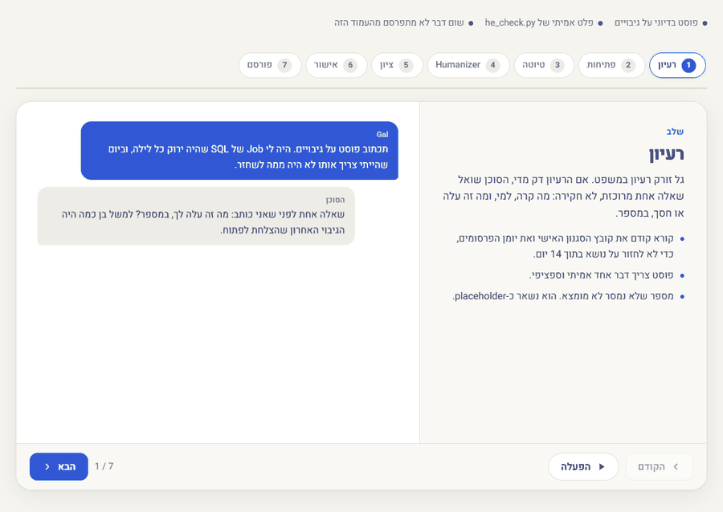
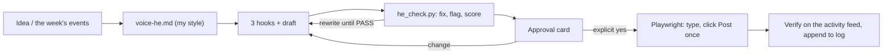

<p align="center"><a href="https://galasulin.github.io/linkedin-agent-he/"></a></p>

<div align="center">

# linkedin-agent-he

**סוכן לינקדאין בעברית ל-Claude: כותב, מאנש ומדרג כל טיוטה, ומפרסם רק אחרי שאני אומר "כן".**

🇬🇧 [English](README.md) · 🇮🇱 עברית


[**דמו חי**](https://galasulin.github.io/linkedin-agent-he/) · [מסכים](#מסכים) · [ארכיטקטורה](#ארכיטקטורה) · [טכנולוגיה](#פרמטרים-טכניים)

</div>

<p align="center"><a href="https://galasulin.github.io/linkedin-agent-he/"></a><br><sub>הדמו החי עובר צעד אחר צעד על כל התהליך, עם פוסט בדיוני ופלט אמיתי של <code>he_check.py</code>.</sub></p>

<div dir="rtl" align="right">

## במבט מהיר

| | |
|---|---|
| **סוג** | סקיל ל-Claude ‏(`SKILL.md`), בודק טקסט עברי עצמאי (`he_check.py`) ודף דמו אינטראקטיבי |
| **סטטוס** | בשימוש יומיומי בלינקדאין שלי |
| **סטאק** | Claude Agent Skills · ‏Playwright MCP · ‏Python 3 (ספרייה סטנדרטית בלבד) · מחבר Google Drive |
| **התפקיד שלי** | זרימת העבודה, כללי האישור והבטיחות, ספריית הפתיחות בעברית, כללי ה-humanizer, שלבי הפרסום בדפדפן, הבודק והדמו |
| **דמו חי** | [galasulin.github.io/linkedin-agent-he](https://galasulin.github.io/linkedin-agent-he/) |
| **שפות** | עברית (פוסטים וכל תשובות הסוכן) · אנגלית (הוראות הסקיל ותיעוד) · הדמו בשתיהן |

## מסכים

<table>
<tr>
<td width="33%"><a href="docs/assets/demo-1.png"></a><br><sub><b>רעיון</b> · שאלה אחת מרוכזת, ומספר חסר הופך ל-placeholder</sub></td>
<td width="33%"><a href="docs/assets/demo-2.png"></a><br><sub><b>Humanizer</b> · תיקונים אוטומטיים וביטויים שחוקים מסומנים בטיוטה</sub></td>
<td width="33%"><a href="docs/assets/demo-3.png"></a><br><sub><b>ציון</b> · חמש בדיקות, 18.0 ← 30.0 ← ‏86.1 PASS</sub></td>
</tr>
<tr>
<td><a href="docs/assets/demo-4.png"></a><br><sub><b>כרטיס אישור</b> · חסום כל עוד נשאר placeholder של <code>{{</code></sub></td>
<td><a href="docs/assets/demo-5.png"></a><br><sub><b>פורסם</b> · הדמיית פוסט, אימות אחד בפיד הפעילות</sub></td>
<td><a href="docs/assets/demo-6.png"></a><br><sub><b>מובייל</b> · הדמו ברוחב טלפון, מימין לשמאל</sub></td>
</tr>
</table>

<sub>כל המסכים מדף הדמו. הפוסט בדיוני, ושום דבר לא מתפרסם מהדמו.</sub>

## מה זה

אני מנהל IT. יש לי דברים אמיתיים להגיד על שרתים, גיבויים, רשתות וסייבר, ואין לי זמן להילחם בעורך ריק. כלי כתיבה כלליים מוציאים עברית מתורגמת ומלוטשת מדי, שמזהים אותה מהשורה הראשונה.

אז בניתי סקיל ל-Claude שכותב **בעברית ישראלית טבעית, בקול שלי**, על **שרתים, IT וסייבר**, ו**לא מפרסם שום דבר שלא אישרתי מילה במילה**. כל טיוטה עוברת בודק עברי מקומי שמתקן טיפוגרפיה, מסמן סימני AI ומדרג את הטקסט לפני שאני רואה אותו.

## יכולות מרכזיות

### מצבי עבודה

| מצב | מה מקבלים |
|---|---|
| **פוסט** | 3 פתיחות מתוך 21 נוסחאות hook בעברית ← טיוטה מלאה (900-1,300 תווים, שורה ראשונה ששורדת את החיתוך של כ-140 תווים במובייל, עד 3 האשטגים, בלי לינק בגוף) ← humanizer ← ציון ← כרטיס אישור |
| **תגובה** | 2 הצעות תגובה מסוגים שונים (9 סוגים, למשל הוספת נתון, אי-הסכמה מכבדת, שורה אחת), 2-4 משפטים, בלי פתיחות כמו "פוסט מעולה" |
| **מענה** | התגובות לפוסטים שלי ממוינות לליד / תוכן / עמית / תמיכה / רעש, נספרות ונענות לפי הסדר הזה |
| **תוכנית שבועית** | 3-4 פוסטים בשבוע: הוכחה, דעה, לימוד וסיפור, עם שעות פרסום שמתאימות ל-B2B בישראל; הנושאים נבדקים מול היומן כדי שלא יחזרו בתוך 14 יום |
| **פרופיל** | ציון פרופיל מתוך 100 ב-12 סעיפים ושכתוב לפי סדר עדיפות (כותרת עד 220 תווים, אודות, ניסיון), שמוחל בדפדפן אחרי אישור |
| **קרוסלה · מיחזור · הודעות · תיבה · ניתוח** | טקסט ל-8-10 שקפים (PDF ‏1080×1350 לפי בקשה), מקור אחד ל-3-5 פוסטים, הודעות קצרות, מיון הודעות, וניתוח שיעור מעורבות מקובץ אנליטיקס |

### הכללים שלא נשברים

1. **טיוטה ← אישור ← פרסום.** שום דבר לא עולה בלי "כן / תפרסם / מאשר" מפורש לאותו טקסט בדיוק. כל שינוי אחרי אישור = שואלים שוב. אישור לפוסט אחד הוא אף פעם לא אישור לפוסט הבא.
2. **בלי להמציא.** מספר חסר הופך ל-`{{המספר שלך}}`, ואין פרסום כל עוד נשאר `{{` בטקסט.
3. **פרסום דרך הדפדפן שלי.** הפוסט המאושר מוקלד ללינקדאין דרך Playwright במחשב שלי, שבו אני מתחבר בעצמי. לחיצה אחת על "פוסט", ואז בדיקה בפיד הפעילות שהפוסט מופיע פעם אחת בדיוק. בלי גרידה, בלי לייקים אוטומטיים, בלי תגובות אוטומטיות, בלי הודעות בשמי. תגובות, מענים והודעות מגיעים מוכנים להעתקה, ואני מדביק אותם.
4. **כל טיוטה עוברת humanizer וציון** לפני שאני רואה אותה. מוצג הטקסט הנקי יחד עם הציון, אף פעם לא הציון לבד.
5. **סודיות.** בלי שמות לקוחות או מטופלים, שמות שרתים, כתובות IP או פרטי אבטחה של ספקים, אלא אם כתבתי אותם בעצמי.

### ה-humanizer העברי (`scripts/he_check.py`)

קובץ אחד בלי תלויות, שבנוי למורפולוגיה של עברית (אותיות השימוש ו/ה/ב/כ/ל/ש/מ):

- **מתקן אוטומטית** תווים בלתי נראים, קווים מפרידים ארוכים, מירכאות מסולסלות, שלוש-נקודות ותבליטים;
- **מסמן** 61 ביטויי AI שחוקים בעברית ("בעולם של היום", "חשוב לציין", "לסיכום", "למנף"…), כל אחד עם סיבה והצעת תיקון, ו-9 סימני מבנה ("לא רק… אלא", "זה לא X, זה Y", שורת חשיפה מבוימת, שלישיות, אימוג'י של AI, קיר האשטגים, פיתיון מעורבות, ניקוד);
- **מדרג** חמש בדיקות (קצב, קונקרטיות, ביטויים שחוקים, טביעת אצבע, קול) לציון אנושי 0-100: ‏`PASS` מ-70 ומעלה, בלי בדיקה מתחת ל-55.

<div dir="ltr">

```text
python scripts/he_check.py examples/sample-draft.txt --fix   # 18.0  FLAGGED
python scripts/he_check.py examples/sample-final.txt         # 86.1  PASS
python tests/test_he_check.py                                # 3 smoke tests
```

</div>

זו היוריסטיקה מקומית ולא גלאי AI מסחרי, והסקיל אף פעם לא טוען שטקסט "בלתי ניתן לזיהוי". שתי הדוגמאות בדיוניות, לא פוסטים אמיתיים.

## ארכיטקטורה


הסקיל הוא קובץ `SKILL.md` אחד ש-Claude טוען כשאני מבקש עבודה על לינקדאין. הוא קורא שני קבצים פרטיים מה-Google Drive שלי (`voice-he.md`, פרופיל הסגנון, ו-`log-he.md`, שורה לכל פוסט שפורסם), בוחר מצב וכותב טיוטה. שלב ה-humanizer כותב את `he_check.py` (מוטמע מילה במילה ב-`SKILL.md`, זהה ל-`scripts/he_check.py`) לתיקיית העבודה של השיחה, מריץ אותו עם `--fix`, משכתב כל שורה מסומנת ומריץ שוב עד שהטקסט עובר. כרטיס האישור הוא השער היחיד לשכבת הפרסום: ‏Playwright MCP מפעיל את הדפדפן במחשב שלי, מקליד את הטקסט המאושר בדיוק, לוחץ "פוסט" פעם אחת, מאמת בפיד ומוסיף שורה ליומן.

### זרימה

<div dir="ltr">



</div>

## פרמטרים טכניים

| פרמטר | ערך |
|---|---|
| הסקיל | `SKILL.md`, ‏307 שורות: 5 כללי זהב, 10 מצבים, ופרקים H ‏(humanizer), ‏P ‏(פרסום), ‏P2 ‏(עריכת פרופיל), ‏V ‏(תבנית סגנון), ‏S ‏(קוד הבודק) |
| ספריית פתיחות | 21 נוסחאות hook בעברית, ממוספרות, והמספר מופיע בכרטיס האישור וביומן |
| סיווג תגובות ומענים | 9 סוגי תגובה · 5 קבוצות מענה (ליד, תוכן, עמית, תמיכה, רעש) |
| ציון פרופיל | 12 סעיפים משוקללים שמסתכמים ב-100 |
| מבנה פוסט | 900-1,300 תווים · שורת פתיחה ששורדת חיתוך של כ-140 תווים במובייל · עד 3 האשטגים · בלי לינק בגוף |
| הבודק | `scripts/he_check.py`, ‏140 שורות, ‏Python 3 עם ספרייה סטנדרטית בלבד (`json`, ‏`re`, ‏`statistics`, ‏`unicodedata`) |
| כללי הבודק | 61 ביטויים שחוקים עם התאמה שמכירה אותיות שימוש · 9 ביטויים רגולריים למבנה · 11 החלפות טיפוגרפיות · הסרת תווי Unicode מסוג `Cf` (בלתי נראים) |
| חמש הבדיקות | קצב: מקדם השונות של אורכי המשפטים (לפחות 4 משפטים) · קונקרטיות: מספרים ומונחים טכניים באנגלית ל-100 מילים · ביטויים שחוקים ל-100 מילים · טביעת אצבע: תווים בלתי נראים, קווים ארוכים, מירכאות מסולסלות ושלוש-נקודות ל-1,000 תווים · קול: גוף ראשון ושני 40%, שפה מדוברת 25%, סימני מבנה 35% |
| ציון כולל | `0.6 × ממוצע + 0.4 × מינימום` של חמש הבדיקות |
| פסיקות | `PASS` מ-70 ומעלה וכל בדיקה לפחות 55 · `REVIEW` מ-50 · `FLAGGED` מתחת ל-50 · קוד יציאה 0 רק ב-`PASS` |
| שורת פקודה | `he_check.py <file \| -> [--fix] [--json]`; ‏`--fix` כותב `<name>.clean.txt` ומדרג לפני ואחרי; פלט UTF-8 גם בקונסולת Windows |
| סבב שכתוב | 2 סבבים זה נורמלי; אחרי 4 סבבים בלי `PASS` הטיוטה נזרקת ונכתבת מחדש |
| תוצאות הדוגמאות | `sample-draft.txt` ‏18.0 FLAGGED ← ‏30.0 אחרי `--fix` ← ‏`sample-final.txt` ‏86.1 PASS |
| בדיקות | `tests/test_he_check.py`, ‏3 בדיקות smoke (רצות עם pytest או בלעדיו) |
| פרסום | Playwright MCP על הדפדפן שלי, שבו אני מחובר · סימון אלמנטים ב-`data-cl` דרך `browser_evaluate` · לחיצה אחת · קריאה חוזרת מפיד הפעילות |
| אחסון | `voice-he.md` ו-`log-he.md` ב-Google Drive, אף פעם לא בריפו |
| דף הדמו | `docs/index.html`, קובץ יחיד (כ-71KB), ‏7 שלבים, מעבר עברית/אנגלית, מצב בהיר/כהה, נתונים בדיוניים |

## החלטות הנדסיות

| ההחלטה | למה | המחיר |
|---|---|---|
| **הבודק מסמן עברית, אף פעם לא משכתב אותה** | אותיות השימוש והתאמת המין הופכות שכתוב ב-regex למסוכן. רק הטיפוגרפיה מתוקנת אוטומטית; את השורות המסומנות המודל משכתב לפי שיקול דעת. | כל סימון עולה סבב שכתוב. |
| **הציון הכולל נותן משקל לבדיקה החלשה** | `0.6 × ממוצע + 0.4 × מינימום` ורצפה של 55 מונעים מבדיקה חזקה אחת להסתיר בדיקה גרועה. | פוסטים קצרים מקבלים 50 ניטרלי בבדיקות שתלויות באורך, והשאר חייבות לעבור. |
| **placeholder חוסם פרסום** | מספר חסר הופך ל-`{{…}}` במקום מספר מומצא; כרטיס האישור מסרב כל עוד נשאר `{{`. | שאלה נוספת אליי על כל עובדה חסרה. |
| **פרסום דרך הדפדפן שלי, לחיצה אחת, בלי ניסיון חוזר** | בלי מפתחות API ובלי שירות אוטומציה חיצוני; אני מתחבר בעצמי. פוסט כפול גרוע מפוסט חסר, ולכן אימות שנכשל עוצר ושואל. | המחשב שלי צריך להיות דלוק, ובדיקה ידנית כשהאימות נכשל. |
| **הבודק מוטמע מילה במילה ב-`SKILL.md`** | הסקיל עצמאי: קובץ אחד מתקין הכול, ו-`scripts/he_check.py` נשאר זהה לשימוש מקומי ולבדיקות. | שני עותקים שצריך לשמור מסונכרנים. |
| **הסגנון והיומן ב-Drive, לא בריפו** | הסגנון האישי והיסטוריית הפרסומים נשארים פרטיים; היומן גם מונע חזרה על נושא בתוך 14 יום. | הסקיל תלוי במחבר Drive, עם חלופה בתוך השיחה. |

## התקנה

מעתיקים את `SKILL.md` לתיקיית הסקילים של Claude בשם `linkedin-agent-he`, מחליפים את `{{PROFILE_HANDLE}}` בכינוי שלכם בלינקדאין, ומחברים דפדפן Playwright MCP שאתם מתחברים אליו בעצמכם.

## סטטוס

בשימוש יומיומי. טיוטות, עריכות פרופיל ופוסטים עוברים כולם דרך כרטיס האישור.

## מבנה הריפו

<div dir="ltr">

```
.
├── SKILL.md                    # the agent skill (modes, rules, publishing, embedded checker)
├── scripts/he_check.py         # Hebrew humanizer + 5-check scorer, no dependencies
├── tests/test_he_check.py      # 3 smoke tests
├── examples/
│   ├── sample-draft.txt        # fictional AI-sounding draft (18.0 FLAGGED)
│   └── sample-final.txt        # its rewrite (86.1 PASS)
├── docs/
│   ├── index.html              # interactive demo (GitHub Pages)
│   └── assets/                 # demo.gif + 6 screenshots
├── LICENSE                     # MIT
└── README.md / README.he.md
```

</div>

## פרטיות והיקף

קובץ הסגנון ויומן הפרסומים (`voice-he.md`, ‏`log-he.md`) נמצאים בכונן הענן שלי, אף פעם לא בריפו. הדוגמאות ופוסט הדמו בדיוניים. הסקיל אף פעם לא מתחבר בשמי, לא מקליד סיסמה, ולא נוגע ב-"פתוח/ה ל" או בהצעות Premium.

</div>

---

<div align="center"><b>Built by <a href="https://github.com/galasulin">Gal Asulin</a>, IT Manager</b></div>
