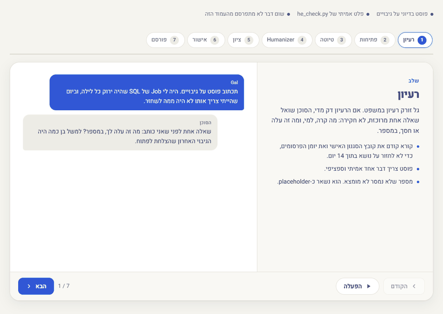

# ✍️ linkedin-agent-he

### סוכן לינקדאין בעברית ל-Claude: כותב, מאנש ומדרג כל טיוטה, ומפרסם רק אחרי שאני אומר "כן".

🇬🇧 [**English version**](README.md)

**[▶ Live demo](https://galasulin.github.io/linkedin-agent-he/)** · מעבר צעד-אחר-צעד על כל התהליך, עם פוסט בדיוני ופלט אמיתי של `he_check.py`

---

## למה בניתי את זה

אני מנהל IT. יש לי דברים אמיתיים להגיד על שרתים, גיבויים, רשתות וסייבר, ואין לי זמן להילחם בעורך ריק. כלי כתיבה כלליים מוציאים עברית מתורגמת ומלוטשת מדי, שמזהים אותה מהשורה הראשונה.

אז בניתי סקיל ל-Claude שכותב **בעברית ישראלית טבעית, בקול שלי**, על **שרתים, IT וסייבר**, ו**לא מפרסם שום דבר שלא אישרתי מילה במילה**.

## מה הוא עושה

| מצב | מה מקבלים |
|---|---|
| **פוסט** | 3 פתיחות מתוך 21 נוסחאות hook בעברית ← טיוטה מלאה (900-1,300 תווים) ← humanizer ← ציון ← כרטיס אישור |
| **תגובה / מענה** | 2 הצעות תגובה מסוגים שונים; מיון התגובות לפוסט שלי לפי סוג |
| **תוכנית שבועית** | 3-4 פוסטים בשבוע: הוכחה, דעה, לימוד וסיפור, עם שעות פרסום שמתאימות לישראל |
| **פרופיל** | ציון פרופיל מתוך 100 ב-12 סעיפים, ושכתוב לפי סדר עדיפות |
| **קרוסלה · מיחזור · הודעות · תיבה · ניתוח** | טקסט לשקפים, מקור אחד ל-5 פוסטים, הודעות קצרות, מיון הודעות וניתוח מעורבות |

## הכללים שלא נשברים

1. **טיוטה ← אישור ← פרסום.** שום דבר לא עולה בלי "כן / תפרסם / מאשר" מפורש לאותו טקסט בדיוק. כל שינוי אחרי אישור = שואלים שוב.
2. **בלי להמציא.** מספר חסר הופך ל-`{{המספר שלך}}`, ואין פרסום כל עוד נשאר `{{` בטקסט.
3. **פרסום דרך הדפדפן שלי.** הפוסט המאושר מוקלד ללינקדאין דרך Playwright במחשב שלי, שבו אני מתחבר בעצמי. לחיצה אחת על "פוסט", ואז בדיקה בפיד הפעילות שהפוסט מופיע פעם אחת בדיוק. בלי גרידה, בלי לייקים אוטומטיים, בלי תגובות אוטומטיות, בלי הודעות בשמי.
4. **כל טיוטה עוברת humanizer וציון** לפני שאני רואה אותה.
5. **סודיות.** בלי שמות לקוחות או מטופלים, שמות שרתים, כתובות IP או פרטי אבטחה של ספקים, אלא אם כתבתי אותם בעצמי.

## ה-humanizer העברי (`scripts/he_check.py`)

קובץ אחד בלי תלויות, שבנוי למורפולוגיה של עברית (אותיות השימוש ו/ה/ב/כ/ל/ש/מ):

- **מתקן אוטומטית** תווים בלתי נראים, קווים מפרידים ארוכים, מירכאות מסולסלות ושלוש-נקודות;
- **מסמן** ביטויי AI שחוקים בעברית וסימני מבנה ("לא רק… אלא", "זה לא X, זה Y", שלישיות, קיר האשטגים);
- **מדרג** חמש בדיקות לציון אנושי 0-100: ‏PASS מ-70 ומעלה, בלי בדיקה מתחת ל-55.

הדוגמאות בתיקייה `examples` בדיוניות. טיוטה שחוקה מקבלת 18.0 (FLAGGED), והשכתוב שלה מקבל 86.1 (PASS). זו היוריסטיקה מקומית ולא גלאי AI מסחרי, והסקיל אף פעם לא טוען שטקסט "בלתי ניתן לזיהוי".

## הסטאק

Claude Agent Skills · ‏Claude Code / Cowork · ‏Playwright MCP · ‏Python 3 (ספרייה סטנדרטית בלבד) · מחבר Google Drive לקובץ הסגנון וליומן.

## התפקיד שלי

תכננתי את זרימת העבודה, כללי האישור והבטיחות, ספריית הפתיחות בעברית, כללי ה-humanizer, שלבי הפרסום בדפדפן ואת הבודק. אני משתמש בו בלינקדאין שלי.

## סטטוס

בשימוש יומיומי. טיוטות, עריכות פרופיל ופוסטים עוברים כולם דרך כרטיס האישור.

---

**Built by [Gal Asulin](https://github.com/galasulin), IT Manager**

