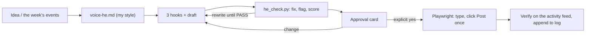

<div align="center">

# ✍️ linkedin-agent-he

### A Hebrew-first LinkedIn agent for Claude: it writes, humanizes and scores every draft, and publishes only after I say "yes".


🇮🇱 [**גרסה עברית**](README.he.md)

</div>

---

## Why I built it

I'm an IT manager. I have real things to say about servers, backups, networks and security, and no time to fight a blank LinkedIn editor. Generic AI writing tools produce translated-sounding, over-polished Hebrew that readers spot in one line.

So I built a skill for Claude that writes **in natural Israeli Hebrew, in my voice**, about **servers / IT and cyber**, and that **never publishes anything I didn't approve word for word**.

## What it does

| Mode | What you get |
|---|---|
| **POST** | 3 hook options from 21 Hebrew hook formulas → a full draft (900-1,300 chars, mobile-safe first line) → humanizer → score → approval card |
| **COMMENT / REPLY** | 2 comment options of different types; replies under my posts triaged into lead / substance / peer / support / noise |
| **PLAN** | a weekly plan: 3-4 posts mixing proof, opinion, teach and story, with Israeli B2B posting times |
| **PROFILE** | a 12-item /100 profile score and fix-first rewrites (headline, About, experience) |
| **CAROUSEL · REPURPOSE · DM · INBOX · AUDIT** | slide copy, one source → 5 posts, short DMs, inbox sorting, engagement-rate analysis from an export |

## The rules it never breaks

1. **Draft → approval → publish.** Nothing goes live without an explicit "כן / תפרסם / מאשר" for that exact text. Any edit after approval means asking again.
2. **No invented facts.** A missing number becomes `{{המספר שלך}}`, and the agent refuses to publish while any `{{` is left.
3. **Publishing through my own browser.** Approved posts are typed into LinkedIn through Playwright on my computer, where I sign in myself. One click on "Post", then it reads my activity feed to confirm the post appears exactly once. No scraping, no auto-likes, no auto-comments, no DMs sent on my behalf.
4. **Every draft is humanized and scored** before I see it.
5. **Confidentiality.** No client or patient names, internal hosts, IPs or vendor security details unless I wrote them into the post myself.

## The Hebrew humanizer (`scripts/he_check.py`)

A single-file, dependency-free checker built for Hebrew morphology (the one-letter prefixes ו/ה/ב/כ/ל/ש/מ):

- **auto-fixes** invisible characters, em/en dashes, curly quotes, ellipses and bullets;
- **flags** Hebrew AI stock phrases ("בעולם של היום", "חשוב לציין", "לסיכום", "למנף"…) and structural tells ("לא רק… אלא", "זה לא X, זה Y", rule-of-three, hashtag walls, AI emoji);
- **scores** five checks (burstiness, concreteness, stock phrases, fingerprint, voice) into a 0-100 human score: `PASS` at 70+ with no check under 55.

```text
python scripts/he_check.py examples/sample-draft.txt --fix   # 18.0  FLAGGED
python scripts/he_check.py examples/sample-final.txt         # 86.1  PASS
python tests/test_he_check.py                                # 3 smoke tests
```

It is a local heuristic, not a commercial AI detector, and the skill never claims a text is "undetectable". The two examples are fictional samples, not real posts.

## How it runs



The voice profile and the publishing log (`voice-he.md`, `log-he.md`) live in my own cloud drive, never in this repo.

## Install

Copy `SKILL.md` into your Claude skills folder as `linkedin-agent-he`, replace `{{PROFILE_HANDLE}}` with your LinkedIn handle, and connect a Playwright MCP browser that you sign in to yourself.

## Stack

Claude Agent Skills · Claude Code / Cowork · Playwright MCP · Python 3 (standard library only) · a Google Drive connector for the voice profile and the log.

## My role

I designed the workflow, the approval and safety rules, the Hebrew hook library and humanizer rules, the browser publishing steps and the checker. I use it for my own LinkedIn.

## Status

In daily use. Drafts, profile edits and posts all go through the approval card.

---

<div align="center">

**Built by [Gal Asulin](https://github.com/galasulin), IT Manager**

</div>
