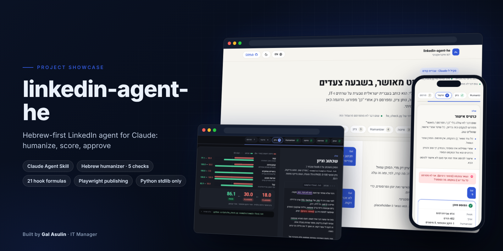
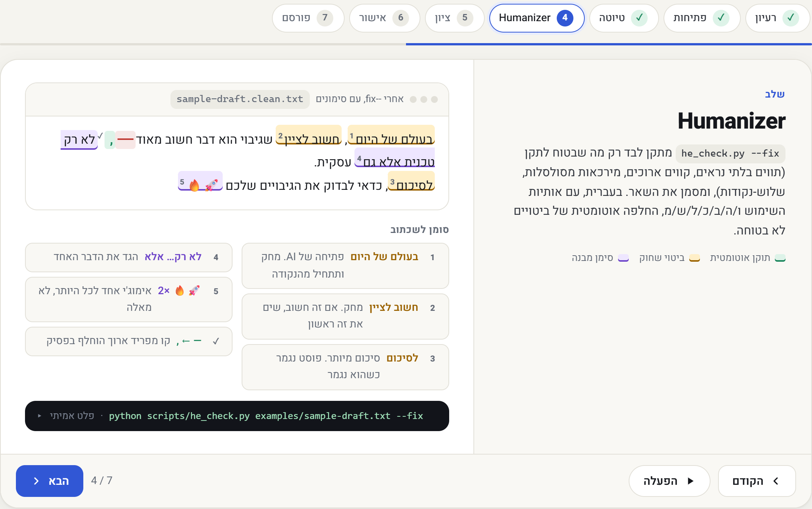
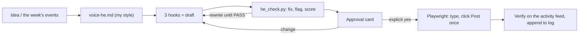

<p align="center"><a href="https://galasulin.github.io/linkedin-agent-he/"></a></p>

<div align="center">

# linkedin-agent-he

**A Hebrew-first LinkedIn agent for Claude: it writes, humanizes and scores every draft, and publishes only after I say "yes".**

🇬🇧 English · 🇮🇱 [עברית](README.he.md)


[**Live demo**](https://galasulin.github.io/linkedin-agent-he/) · [Screens](#screens) · [Architecture](#architecture) · [Tech](#technical-parameters)

</div>

<p align="center"><a href="https://galasulin.github.io/linkedin-agent-he/"></a><br><sub>The live demo steps through the whole flow with a fictional post and the real output of <code>he_check.py</code>.</sub></p>

## At a glance

| | |
|---|---|
| **Type** | Claude Agent Skill (`SKILL.md`) + a standalone Hebrew text checker (`he_check.py`) + an interactive demo page |
| **Status** | In daily use on my own LinkedIn |
| **Stack** | Claude Agent Skills · Playwright MCP · Python 3 (standard library only) · Google Drive connector |
| **My role** | Workflow, approval and safety rules, Hebrew hook library, humanizer rules, browser publishing steps, the checker, the demo |
| **Live demo** | [galasulin.github.io/linkedin-agent-he](https://galasulin.github.io/linkedin-agent-he/) |
| **Languages** | Hebrew (posts and all agent replies) · English (skill instructions, docs) · demo page in both |

## Screens

<table>
<tr>
<td width="33%"><a href="docs/assets/demo-1.png"></a><br><sub><b>Idea</b> · one batched question, missing number becomes a placeholder</sub></td>
<td width="33%"><a href="docs/assets/demo-2.png"></a><br><sub><b>Humanizer</b> · auto-fixes and flagged stock phrases on the draft</sub></td>
<td width="33%"><a href="docs/assets/demo-3.png"></a><br><sub><b>Score</b> · five checks, 18.0 → 30.0 → 86.1 PASS</sub></td>
</tr>
<tr>
<td><a href="docs/assets/demo-4.png"></a><br><sub><b>Approval card</b> · blocked while a <code>{{</code> placeholder is left</sub></td>
<td><a href="docs/assets/demo-5.png"></a><br><sub><b>Published</b> · mock post, verified once on the activity feed (English UI)</sub></td>
<td><a href="docs/assets/demo-6.png"></a><br><sub><b>Mobile</b> · the demo at phone width, RTL</sub></td>
</tr>
</table>

<sub>All screens come from the demo page. The post is fictional; nothing is published from the demo.</sub>

## What it is

I'm an IT manager. I have real things to say about servers, backups, networks and security, and no time to fight a blank LinkedIn editor. Generic AI writing tools produce translated-sounding, over-polished Hebrew that readers spot in one line.

So I built a skill for Claude that writes **in natural Israeli Hebrew, in my voice**, about **servers / IT and cyber**, and that **never publishes anything I didn't approve word for word**. Every draft runs through a local Hebrew checker that fixes typography, flags AI tells and scores the text before I see it.

## Key capabilities

### Modes

| Mode | What you get |
|---|---|
| **POST** | 3 hook options from 21 Hebrew hook formulas → a full draft (900-1,300 chars, first line survives the ~140-char mobile cut, up to 3 hashtags, no link in the body) → humanizer → score → approval card |
| **COMMENT** | 2 comment options of different types (9 types, e.g. add a data point, respectful disagreement, one-liner), 2-4 sentences, no "great post" openers |
| **REPLY** | Replies under my posts triaged into lead / substance / peer / support / noise, counted, answered in that order |
| **PLAN** | A weekly plan: 3-4 posts mixing proof, opinion, teach and story, with Israeli B2B posting times; themes are checked against the log so they don't repeat within 14 days |
| **PROFILE** | A 12-item /100 profile score and fix-first rewrites (headline ≤ 220 chars, About, experience), applied in the browser after approval |
| **CAROUSEL · REPURPOSE · DM · INBOX · AUDIT** | 8-10 slide copy (1080×1350 PDF on request), one source → 3-5 posts, short DMs, inbox sorting, engagement-rate analysis from an analytics export |

### The rules it never breaks

1. **Draft → approval → publish.** Nothing goes live without an explicit "כן / תפרסם / מאשר" for that exact text. Any edit after approval means asking again. Approval for one post is never approval for the next.
2. **No invented facts.** A missing number becomes `{{המספר שלך}}`, and the agent refuses to publish while any `{{` is left.
3. **Publishing through my own browser.** Approved posts are typed into LinkedIn through Playwright on my computer, where I sign in myself. One click on "Post", then it reads my activity feed to confirm the post appears exactly once. No scraping, no auto-likes, no auto-comments, no DMs sent on my behalf. Comments, replies and DMs are delivered copy-ready for me to paste.
4. **Every draft is humanized and scored** before I see it. The cleaned text is shown with the score, never the score alone.
5. **Confidentiality.** No client or patient names, internal hosts, IPs or vendor security details unless I wrote them into the post myself.

### The Hebrew humanizer (`scripts/he_check.py`)

A single-file, dependency-free checker built for Hebrew morphology (the one-letter prefixes ו/ה/ב/כ/ל/ש/מ):

- **auto-fixes** invisible characters, em/en dashes, curly quotes, ellipses and bullets;
- **flags** 61 Hebrew AI stock phrases ("בעולם של היום", "חשוב לציין", "לסיכום", "למנף"…), each with a reason and a fix, and 9 structural tells ("לא רק… אלא", "זה לא X, זה Y", staged reveal lines, rule-of-three, AI emoji, hashtag walls, engagement bait, niqqud);
- **scores** five checks (burstiness, concreteness, stock phrases, fingerprint, voice) into a 0-100 human score: `PASS` at 70+ with no check under 55.

```text
python scripts/he_check.py examples/sample-draft.txt --fix   # 18.0  FLAGGED
python scripts/he_check.py examples/sample-final.txt         # 86.1  PASS
python tests/test_he_check.py                                # 3 smoke tests
```

It is a local heuristic, not a commercial AI detector, and the skill never claims a text is "undetectable". The two examples are fictional samples, not real posts.

## Architecture


The skill is a single `SKILL.md` that Claude loads when I ask for LinkedIn work. It reads two private files from my Google Drive (`voice-he.md`, the voice profile, and `log-he.md`, one line per published post), picks a mode and writes the draft. The humanizer step writes `he_check.py` (embedded verbatim in `SKILL.md`, identical to `scripts/he_check.py`) to the session scratchpad, runs it with `--fix`, rewrites every flagged line, and reruns it until the text passes. The approval card is the only gate to the publishing layer: Playwright MCP drives the browser on my computer, types the exact approved text, clicks "Post" once, verifies the feed and appends to the log.

### Flow



## Technical parameters

| Parameter | Value |
|---|---|
| Skill | `SKILL.md`, 307 lines: 5 golden rules, 10 modes, sections H (humanizer), P (publish), P2 (profile edits), V (voice template), S (checker source) |
| Hook library | 21 Hebrew hook formulas, numbered and referenced on the approval card and in the log |
| Comment / reply taxonomy | 9 comment types · 5 reply buckets (lead, substance, peer, support, noise) |
| Profile score | 12 weighted items summing to 100 |
| Post shape | 900-1,300 chars · hook line survives ~140-char mobile cut · ≤ 3 hashtags · no link in body |
| Checker | `scripts/he_check.py`, 140 lines, Python 3 standard library only (`json`, `re`, `statistics`, `unicodedata`) |
| Checker rules | 61 stock phrases with prefix-aware matching · 9 structural regexes · 11 typography replacements · Unicode `Cf` (invisible) removal |
| Five checks | Burstiness: sentence-length coefficient of variation (≥ 4 sentences) · Concreteness: numbers + distinct Latin tech terms per 100 words · Stock phrases per 100 words · Fingerprint: invisible chars, em dashes, curly quotes, ellipses per 1,000 chars · Voice: first/second person 40 %, colloquial markers 25 %, structural tells 35 % |
| Overall score | `0.6 × mean + 0.4 × min` of the five checks |
| Verdicts | `PASS` ≥ 70 with every check ≥ 55 · `REVIEW` ≥ 50 · `FLAGGED` below 50 · exit code 0 only on `PASS` |
| CLI | `he_check.py <file \| -> [--fix] [--json]`; `--fix` writes `<name>.clean.txt` and scores before and after; UTF-8 stdout on Windows consoles |
| Rewrite loop | 2 rounds is normal; after 4 rounds without `PASS` the draft is discarded and rewritten |
| Sample results | `sample-draft.txt` 18.0 FLAGGED → 30.0 after `--fix` → `sample-final.txt` 86.1 PASS |
| Tests | `tests/test_he_check.py`, 3 smoke tests (runs with or without pytest) |
| Publishing | Playwright MCP on my own signed-in browser · elements tagged with `data-cl` via `browser_evaluate` · one click · read-back on the activity feed |
| Storage | `voice-he.md` and `log-he.md` in Google Drive, never in the repo |
| Demo page | `docs/index.html`, single file (~71 KB), 7 steps, Hebrew/English toggle, light/dark theme, fictional data |

## Engineering decisions

| Decision | Why | Trade-off |
|---|---|---|
| **The checker flags Hebrew, it never rewrites it** | Hebrew prefixes and gender agreement make regex rewrites unsafe. Only typography is auto-fixed; the model rewrites flagged lines by judgment. | Every flag costs a rewrite round. |
| **Overall score weights the weakest check** | `0.6 × mean + 0.4 × min` and a 55 floor stop one strong check from hiding a bad one. | Short posts get a neutral 50 on length-based checks and need the other checks to pass. |
| **Placeholders block publishing** | A missing number becomes `{{…}}` instead of an invented one; the approval card refuses while any `{{` remains. | One extra question to me per missing fact. |
| **Publish through my own browser, click once, never retry** | No API keys or third-party automation; I sign in myself. A double post is worse than a missing one, so a failed verification stops and asks. | Needs my computer online and a manual check when verification fails. |
| **Checker embedded verbatim in `SKILL.md`** | The skill is self-contained: one file installs everything, and `scripts/he_check.py` stays identical for local use and tests. | Two copies to keep in sync. |
| **Voice and log live in Drive, not in the repo** | Personal style and the publishing history stay private; the log also prevents repeating a theme within 14 days. | The skill depends on a Drive connector, with an in-conversation fallback. |

## Install

Copy `SKILL.md` into your Claude skills folder as `linkedin-agent-he`, replace `{{PROFILE_HANDLE}}` with your LinkedIn handle, and connect a Playwright MCP browser that you sign in to yourself.

## Status

In daily use. Drafts, profile edits and posts all go through the approval card.

## Repository layout

```
.
├── SKILL.md                    # the agent skill (modes, rules, publishing, embedded checker)
├── scripts/he_check.py         # Hebrew humanizer + 5-check scorer, no dependencies
├── tests/test_he_check.py      # 3 smoke tests
├── examples/
│   ├── sample-draft.txt        # fictional AI-sounding draft (18.0 FLAGGED)
│   └── sample-final.txt        # its rewrite (86.1 PASS)
├── docs/
│   ├── index.html              # interactive demo (GitHub Pages)
│   └── assets/                 # demo.gif + 6 screenshots
├── LICENSE                     # MIT
└── README.md / README.he.md
```

## Privacy & scope

The voice profile and the publishing log (`voice-he.md`, `log-he.md`) live in my own cloud drive, never in this repo. The examples and the demo post are fictional. The skill never logs in for me, never types a password, and never touches "Open to Work" or Premium prompts.

---

<div align="center"><b>Built by <a href="https://github.com/galasulin">Gal Asulin</a>, IT Manager</b></div>
