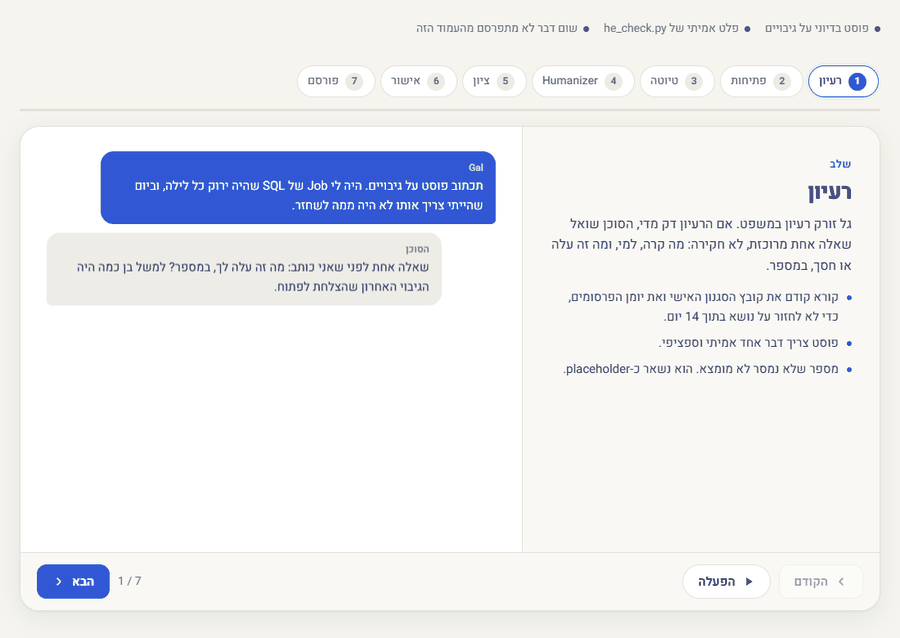
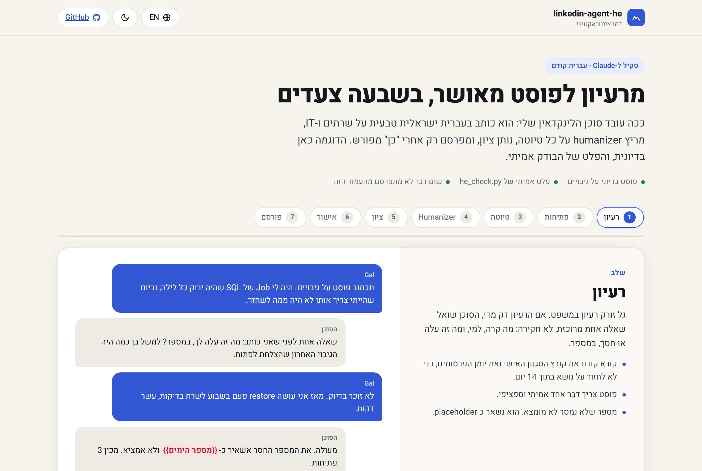
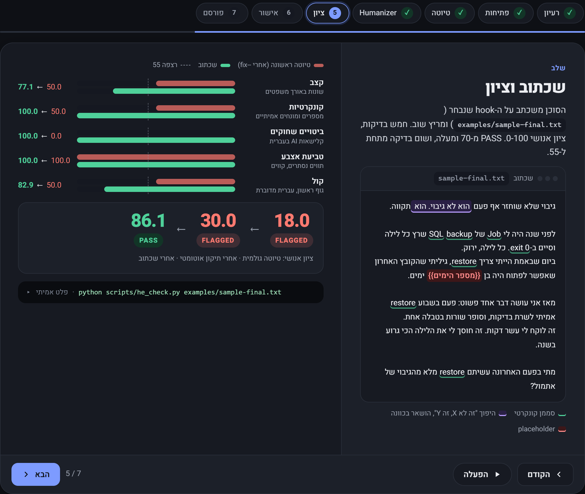
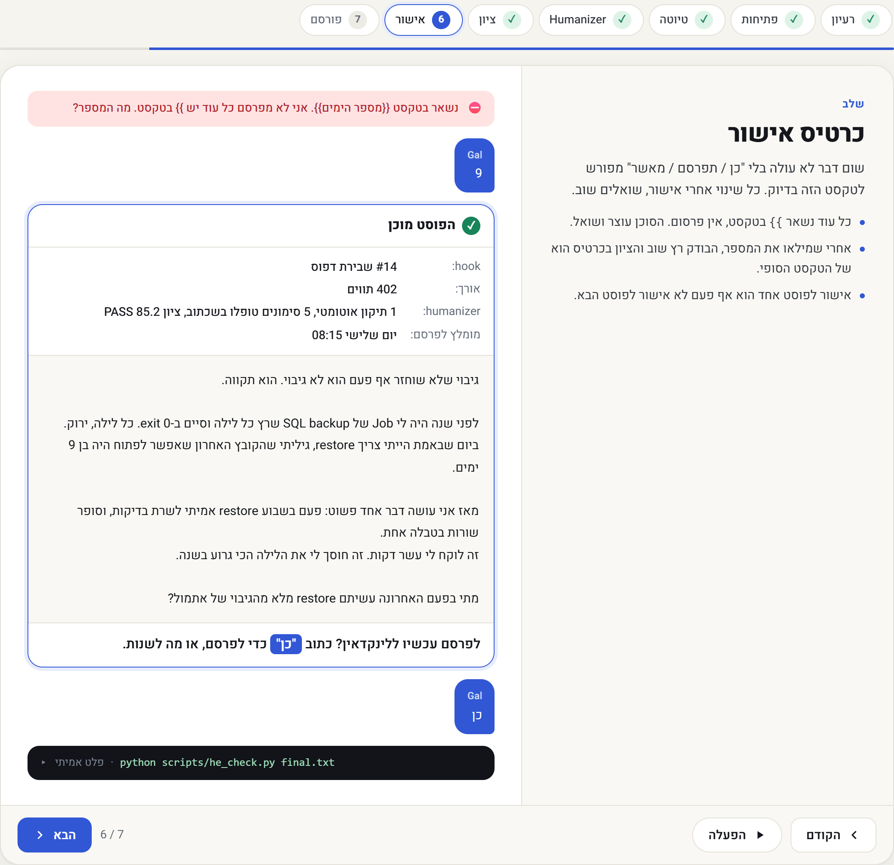
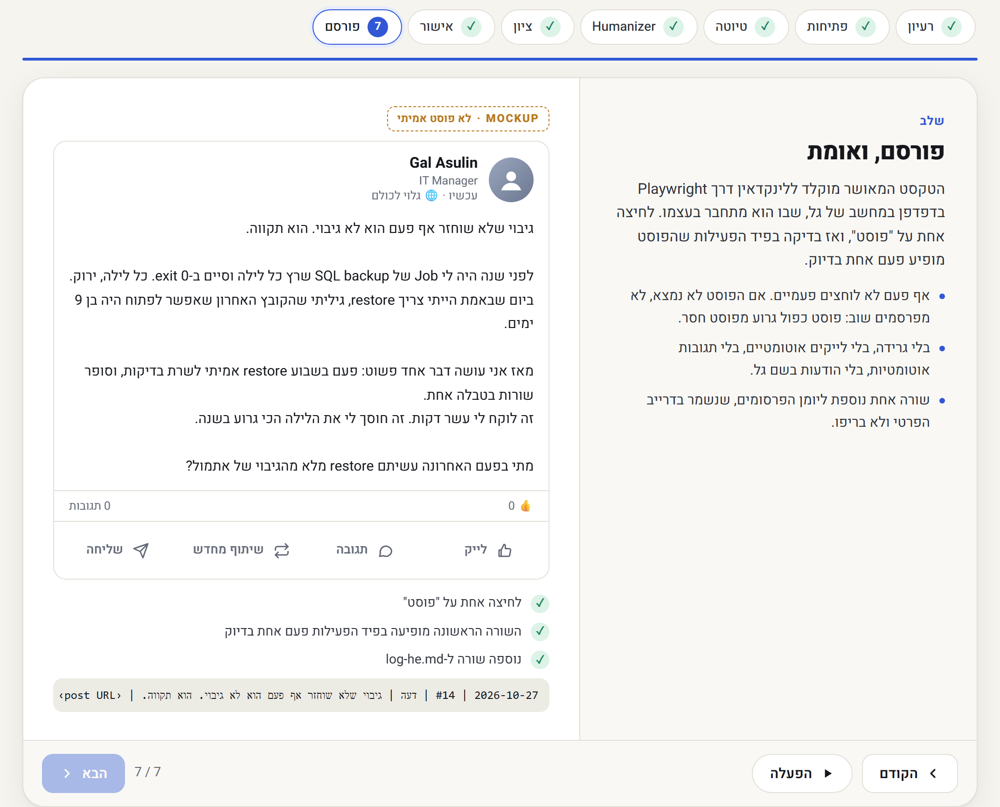
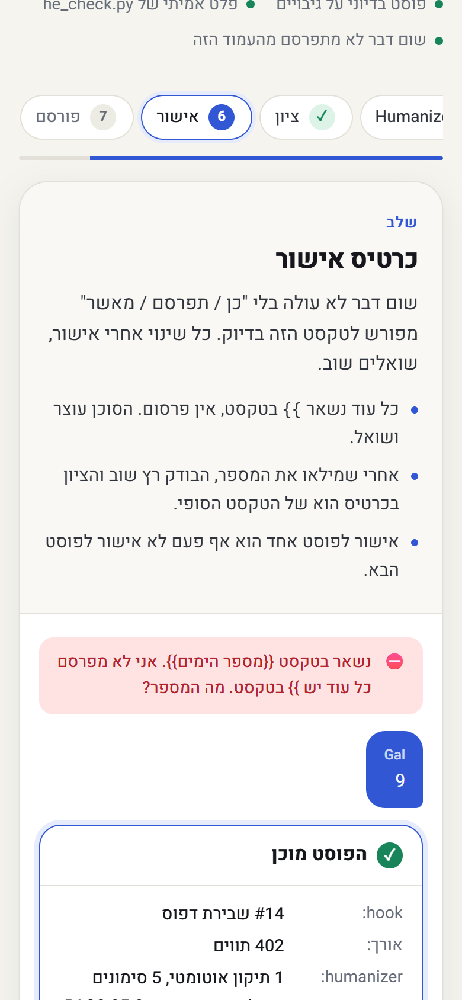
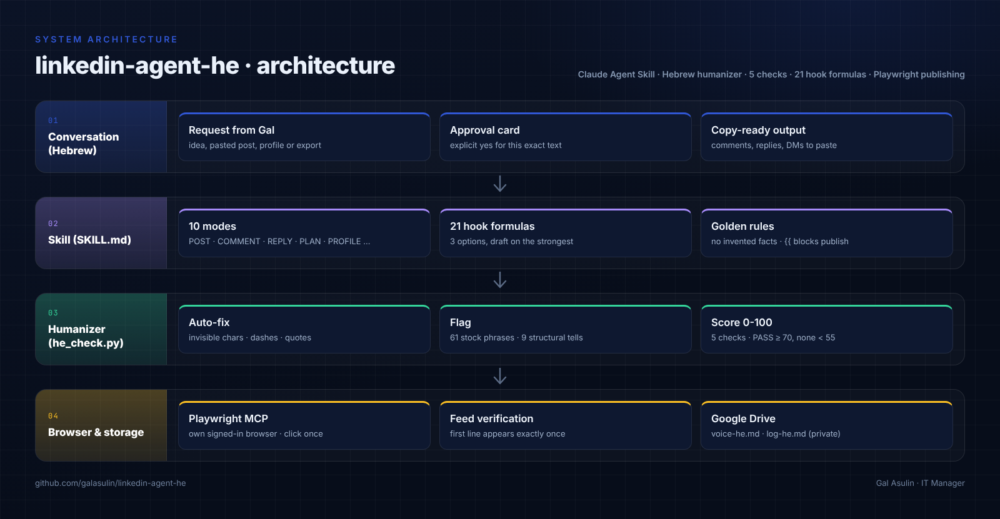

<p align="center"><a href="https://galasulin.github.io/linkedin-agent-he/"></a></p>

<div align="center">

# linkedin-agent-he

**A Hebrew LinkedIn agent that runs on Claude: it finds topics, writes the post, designs a poster, sends everything for approval, and publishes only after the account owner explicitly approves.**

🇬🇧 English · 🇮🇱 [עברית](README.he.md)


[**Live demo**](https://galasulin.github.io/linkedin-agent-he/) · [Screens](#screens) · [Architecture](#architecture) · [Tech](#technical-parameters)

</div>

<p align="center"><a href="https://galasulin.github.io/linkedin-agent-he/"></a><br><sub>The live demo steps through the whole flow with a fictional post and the real output of <code>he_check.py</code>.</sub></p>

## At a glance

| | |
|---|---|
| **Type** | Claude Agent Skill (`SKILL.md`) + a standalone Hebrew text checker (`he_check.py`) + an interactive demo page |
| **Status** | In regular use on the account owner's LinkedIn |
| **Stack** | Claude Agent Skills · Playwright MCP · Python 3 (standard library only) · Google Drive connector |
| **My role** | Workflow, approval and safety rules, Hebrew hook library, humanizer rules, browser publishing steps, the checker, the demo |
| **Live demo** | [galasulin.github.io/linkedin-agent-he](https://galasulin.github.io/linkedin-agent-he/) |
| **Languages** | Hebrew (posts and all agent replies) · English (skill instructions, docs) · demo page in both |

## Screens

<table>
<tr>
<td width="33%"><a href="docs/assets/demo-1.png"></a><br><sub><b>Idea</b> · one batched question, missing number becomes a placeholder</sub></td>
<td width="33%"><a href="docs/assets/demo-2.png"></a><br><sub><b>Humanizer</b> · auto-fixes and flagged stock phrases on the draft</sub></td>
<td width="33%"><a href="docs/assets/demo-3.png"></a><br><sub><b>Score</b> · five checks, 18.0 → 30.0 → 86.1 PASS</sub></td>
</tr>
<tr>
<td><a href="docs/assets/demo-4.png"></a><br><sub><b>Approval card</b> · blocked while a <code>{{</code> placeholder is left</sub></td>
<td><a href="docs/assets/demo-5.png"></a><br><sub><b>Published</b> · mock post, verified once on the activity feed</sub></td>
<td><a href="docs/assets/demo-6.png"></a><br><sub><b>Mobile</b> · the demo at phone width, RTL</sub></td>
</tr>
</table>

<sub>All screens come from the demo page. The post is fictional; nothing is published from the demo.</sub>

## What it is

A Hebrew LinkedIn agent that runs on Claude. It finds a topic, writes the post, designs a poster for it, sends the text, the poster and the posting time for approval, and publishes only after the account owner explicitly approves.

Generic AI writing tools produce translated-sounding, over-polished Hebrew that readers spot in one line. This agent writes natural Israeli Hebrew about AI, information security and servers, checks every number against its primary source, and runs every draft through a local Hebrew checker that flags AI phrasing and scores the text before anyone sees it.

## Key capabilities

### Modes

| Mode | What you get |
|---|---|
| **TOPICS** | Candidate topics from two sources: news from the last 72 hours (AI, information security, servers) and an idea bank that is refreshed every day. Every number is checked against the primary source. |
| **POST** | 3 hook options from 21 Hebrew hook formulas → a full draft whose shape changes from post to post (900-1,300 chars, first line survives the ~140-char mobile cut, up to 3 hashtags, no link in the body) → humanizer → score → poster → approval |
| **POSTER** | One 1080×1350 poster for every post, in one of 10 visual styles that never repeats the previous ones, designed after looking at current work on the web |
| **VIDEO** | A 15-30 second video for special posts |
| **COMMENT** | 2 comment options of different types for other people's posts (9 types, e.g. add a data point, respectful disagreement, one-liner), 2-4 sentences, no "great post" openers. Copy-ready, never sent automatically |
| **REPLY** | Replies to comments under the owner's posts, triaged into lead / substance / peer / support / noise and answered in that order. Copy-ready, never sent automatically |
| **PLAN** | A weekly plan: one regular post every day, Sunday to Thursday, each at a different posting time; themes are checked against the log so they don't repeat within 14 days |
| **CAROUSEL** | A PDF carousel once every two weeks, 8-10 slides at 1080×1350 |
| **EXTRA POST** | An additional post on top of the daily one when there is a major AI announcement |
| **PROFILE** | A 12-item /100 profile score and fix-first rewrites (headline ≤ 220 chars, About, experience), applied in the browser after approval |
| **MESSAGES** | Short messages, written copy-ready for the owner to send |
| **MONTHLY REVIEW** | Reads the numbers of the account owner's own posts only (impressions, comments), compares them by post type, hook, posting hour and poster, and returns conclusions |

### The rules it never breaks

1. **Draft → approval → publish.** The text, the poster and the posting time all go to approval. Nothing goes live without an explicit "כן / תפרסם / מאשר". Any change after approval sends the post back for a new approval. No answer means nothing is published. Approval for one post is never approval for the next.
2. **No invented facts.** No invented events, numbers or clients. Every number is checked against its primary source. A missing number becomes `{{המספר שלך}}`, and the agent refuses to publish while any `{{` is left.
3. **Publishing through the account owner's own browser.** Approved posts are typed into LinkedIn through a Playwright browser on the owner's computer, where the owner signs in personally. The agent never types a password, works only in the LinkedIn tab and leaves every other tab alone, and clicks "Post" exactly once. It then checks that the post went up once, right-aligned, with active hashtags, and adds the source in the first comment.
4. **Every draft is humanized and scored** before anyone sees it. The cleaned text is shown with the score, never the score alone.
5. **RTL.** Every line starts with a Hebrew word. Direction marks are added only at publishing time.
6. **Confidentiality.** No client names, internal hosts, IPs or vendor security details unless the owner wrote them into the post.

### A poster for every post

Every post gets a 1080×1350 poster with a fixed signature strip at the bottom. The design comes from a library of 10 styles, and a style is not repeated until the others have been used:

Apple-style 3D · 3D sculpture · bold minimalism · magazine chart · neo-brutalism · warning signs · Y2K chrome · collage · glowing gradient · glitch

Before each poster the agent looks at current design work on the web for inspiration, then builds one graphic from the real numbers of the story. The poster is built as HTML and captured to PNG.

### Video

Special posts can get a 15-30 second video instead of a poster. It goes through the same approval as the text.

### Cadence

One regular post every day, Sunday to Thursday, each at a different posting time. An extra post when there is a major AI announcement. A PDF carousel once every two weeks.

### What it does not do

It does not scan the feed. It does not comment or connect with people automatically. It does not send private messages. It does not publish without approval.

### The Hebrew humanizer (`scripts/he_check.py`)

A single-file, dependency-free checker built for Hebrew morphology (the one-letter prefixes ו/ה/ב/כ/ל/ש/מ):

- **auto-fixes** invisible characters, em/en dashes, curly quotes, ellipses and bullets;
- **flags** 61 Hebrew AI stock phrases ("בעולם של היום", "חשוב לציין", "לסיכום", "למנף"…), each with a reason and a fix, and 9 structural tells ("לא רק… אלא", "זה לא X, זה Y", staged reveal lines, rule-of-three, AI emoji, hashtag walls, engagement bait, niqqud);
- **scores** five checks (burstiness, concreteness, stock phrases, fingerprint, voice) into a 0-100 human score: `PASS` at 70+ with no check under 55. The agent's own working target is higher: 85+ before a draft is shown, aiming for 90+.

```text
python scripts/he_check.py examples/sample-draft.txt --fix   # 18.0  FLAGGED
python scripts/he_check.py examples/sample-final.txt         # 86.1  PASS
python tests/test_he_check.py                                # 3 smoke tests
```

It is a local heuristic, not a commercial AI detector, and the skill never claims a text is "undetectable". The two examples are fictional samples, not real posts.

## Architecture



The skill is a single `SKILL.md` that Claude loads when I ask for LinkedIn work. It reads two private files from my Google Drive (`voice-he.md`, the voice profile, and `log-he.md`, one line per published post), picks a mode and writes the draft. The humanizer step writes `he_check.py` (embedded verbatim in `SKILL.md`; `scripts/he_check.py` is the same checker plus one line that sets UTF-8 output for Windows consoles) to the session scratchpad, runs it with `--fix`, rewrites every flagged line, and reruns it until the text passes. The approval card is the only gate to the publishing layer: Playwright MCP drives the browser on my computer, types the exact approved text, clicks "Post" once, verifies the post, adds the source in the first comment and appends to the log.

### Flow

```mermaid
flowchart LR
    A["News of the last 72 h + idea bank"] --> B["Numbers checked against the primary source"]
    B --> C["3 hooks + draft"]
    C --> D["he_check.py: fix, flag, score"]
    D -->|"rewrite until PASS"| C
    D --> P["Poster 1080x1350, HTML to PNG"]
    P --> E["Approval: text, poster, posting time"]
    E -->|"explicit yes"| F["Playwright: LinkedIn tab only, click Post once"]
    F --> G["Verify: posted once, right-aligned, hashtags active"]
    G --> H["Source in the first comment, append to log"]
    E -->|"any change"| C
```



## Technical parameters

| Parameter | Value |
|---|---|
| Skill (published version) | `SKILL.md`, 395 lines: SETUP, 5 golden rules, 11 modes (POST, COMMENT, REPLY, PLAN, PROFILE, CAROUSEL, VIDEO, REPURPOSE, DM, INBOX, AUDIT), sections T (topics), R (RTL), I (poster), H (humanizer), P (publish), P2 (profile edits), V (voice template), S (checker source) |
| Hook library | 21 Hebrew hook formulas, numbered and referenced on the approval card and in the log |
| Comment / reply taxonomy | 9 comment types · 5 reply buckets (lead, substance, peer, support, noise) |
| Profile score | 12 weighted items summing to 100 |
| Post shape | 900-1,300 chars · hook line survives ~140-char mobile cut · ≤ 3 hashtags · no link in body |
| Topic sources | News from the last 72 hours (AI, information security, servers) · an idea bank refreshed daily · every number checked against the primary source |
| RTL rule | Every line starts with a Hebrew word · direction marks added only at publishing time |
| Poster | 1080×1350 · fixed signature strip at the bottom · library of 10 styles with no repeats · web inspiration before each one · one graphic from the story's real numbers · built as HTML, captured to PNG |
| Video | 15-30 seconds, for special posts |
| Cadence | One regular post a day, Sunday to Thursday · a different posting time each time · extra post on a major AI announcement · PDF carousel every two weeks |
| Humanizer target | 85+ before a draft is shown, aiming for 90+ (the checker's own `PASS` line stays at 70) |
| Monthly review | The owner's own posts only: impressions and comments, compared by post type, hook, posting hour and poster |
| Checker | `scripts/he_check.py`, 140 lines, Python 3 standard library only (`json`, `re`, `statistics`, `unicodedata`) |
| Checker rules | 61 stock phrases with prefix-aware matching · 9 structural regexes · 11 typography replacements · Unicode `Cf` (invisible) removal |
| Five checks | Burstiness: sentence-length coefficient of variation (≥ 4 sentences) · Concreteness: numbers + distinct Latin tech terms per 100 words · Stock phrases per 100 words · Fingerprint: invisible chars, em dashes, curly quotes, ellipses per 1,000 chars · Voice: first/second person 40 %, colloquial markers 25 %, structural tells 35 % |
| Overall score | `0.6 × mean + 0.4 × min` of the five checks |
| Verdicts | `PASS` ≥ 70 with every check ≥ 55 · `REVIEW` ≥ 50 · `FLAGGED` below 50 · exit code 0 only on `PASS` |
| CLI | `he_check.py <file \| -> [--fix] [--json]`; `--fix` writes `<name>.clean.txt` and scores before and after; UTF-8 stdout on Windows consoles |
| Rewrite loop | 2 rounds is normal; after 4 rounds without `PASS` the draft is discarded and rewritten |
| Sample results | `sample-draft.txt` 18.0 FLAGGED → 30.0 after `--fix` → `sample-final.txt` 86.1 PASS |
| Tests | `tests/test_he_check.py`, 3 smoke tests (runs with or without pytest) |
| Publishing | Playwright MCP on the owner's own signed-in browser · LinkedIn tab only · no password typed · elements tagged with `data-cl` via `browser_evaluate` · one click · read-back: posted once, right-aligned, hashtags active · source in the first comment |
| Storage | `voice-he.md` and `log-he.md` in Google Drive, never in the repo |
| Demo page | `docs/index.html`, single file (~71 KB), 7 steps, Hebrew/English toggle, light/dark theme, fictional data |

## Engineering decisions

| Decision | Why | Trade-off |
|---|---|---|
| **The checker flags Hebrew, it never rewrites it** | Hebrew prefixes and gender agreement make regex rewrites unsafe. Only typography is auto-fixed; the model rewrites flagged lines by judgment. | Every flag costs a rewrite round. |
| **Overall score weights the weakest check** | `0.6 × mean + 0.4 × min` and a 55 floor stop one strong check from hiding a bad one. | Short posts get a neutral 50 on length-based checks and need the other checks to pass. |
| **Placeholders block publishing** | A missing number becomes `{{…}}` instead of an invented one; the approval card refuses while any `{{` remains. | One extra question to me per missing fact. |
| **Publish through my own browser, click once, never retry** | No API keys or third-party automation; I sign in myself. A double post is worse than a missing one, so a failed verification stops and asks. | Needs my computer online and a manual check when verification fails. |
| **Checker embedded verbatim in `SKILL.md`** | The skill is self-contained: one file installs everything, and `scripts/he_check.py` is the same checker for local use and tests, plus one line for Windows consoles. | Two copies to keep in sync. |
| **Voice and log live in Drive, not in the repo** | Personal style and the publishing history stay private; the log also prevents repeating a theme within 14 days. | The skill depends on a Drive connector, with an in-conversation fallback. |

## Install

Copy `SKILL.md` into your Claude skills folder. This is the generic version: on first use it runs a **SETUP** step that asks you once for your name, role line, profile, topics and posting cadence, then creates a Google Drive folder "LinkedIn" with your voice profile (`voice-he.md`), publishing log (`log-he.md`) and idea bank (`ideas-he.md`). Connect a Playwright MCP browser that you sign in to yourself.

## Status

In regular use. Text, poster and posting time all go through approval, and so do profile edits.

The `SKILL.md` in this repository is the generic version, with no personal details. Each owner's voice profile, topics and publishing log stay in their own private files.

### What's new · 22.11.2026

- A regular post every day, Sunday to Thursday, plus an extra post for major AI announcements.
- A library of 10 poster styles, with no repeats.
- Web inspiration before every poster.
- VIDEO mode: a 15-30 second video for special posts.
- Humanizer target 85+, aiming for 90+.
- A generic version with a SETUP step.

## Repository layout

```
.
├── SKILL.md                    # the agent skill (modes, rules, publishing, embedded checker)
├── scripts/he_check.py         # Hebrew humanizer + 5-check scorer, no dependencies
├── tests/test_he_check.py      # 3 smoke tests
├── examples/
│   ├── sample-draft.txt        # fictional AI-sounding draft (18.0 FLAGGED)
│   └── sample-final.txt        # its rewrite (86.1 PASS)
├── docs/
│   ├── index.html              # interactive demo (GitHub Pages)
│   └── assets/                 # demo.gif + 6 screenshots
├── LICENSE                     # MIT
└── README.md / README.he.md
```

## Privacy & scope

The voice profile and the publishing log (`voice-he.md`, `log-he.md`) live in my own cloud drive, never in this repo. The examples and the demo post are fictional. The skill never logs in for me, never types a password, and never touches "Open to Work" or Premium prompts.

---

<div align="center"><b>Built by <a href="https://github.com/galasulin">Gal Asulin</a>, IT Manager</b></div>
